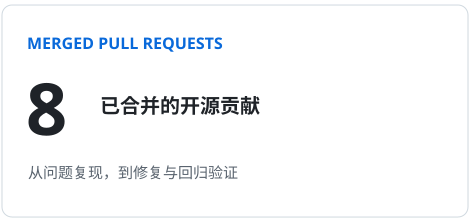
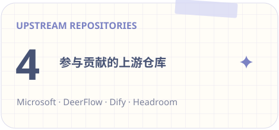
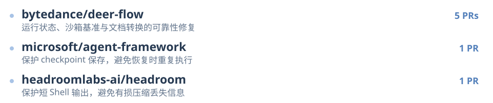

<picture>
  <source media="(prefers-color-scheme: dark)" srcset="./assets/hero-dark.svg">
  
</picture>

### ✎ 关于我

- 关注 **AI Agent、工作流与工具链的可靠性**。
- 从问题复现、边界处理到回归验证，持续参与开源协作。

<picture>
  <source media="(prefers-color-scheme: dark)" srcset="./assets/divider-dark.svg">
  
</picture>

### ▧ 开源贡献手账

<picture>
  <source media="(prefers-color-scheme: dark)" srcset="./assets/merged-dark.svg">
  
</picture>
<picture>
  <source media="(prefers-color-scheme: dark)" srcset="./assets/upstream-dark.svg">
  
</picture>

<!-- CONTRIB:BEGIN -->
<picture>
  <source media="(prefers-color-scheme: dark)" srcset="./assets/contrib-dark.svg">
  
</picture>
<!-- CONTRIB:END -->

### ✦ 已合并 PR

<table width="100%">
<tr>
<td width="40" align="center">✦</td>
<td>

<strong><a href="https://github.com/microsoft/agent-framework/pull/9644">microsoft/agent-framework #9644</a></strong>

保护并行工作流中已完成步骤的 checkpoint 保存，避免兄弟步骤失败后恢复时重复执行。

</td>
</tr>
</table>

<table width="100%">
<tr>
<td width="40" align="center">✦</td>
<td>

<strong><a href="https://github.com/headroomlabs-ai/headroom/pull/4426">headroomlabs-ai/headroom #4426</a></strong>

保护短 Shell 输出，避免有损压缩丢失工具返回信息。

</td>
</tr>
</table>

<table width="100%">
<tr>
<td width="40" align="center">✦</td>
<td>

<strong><a href="https://github.com/bytedance/deer-flow/pull/7659">bytedance/deer-flow #7659</a></strong>

修复文档转换清理失败覆盖原始结果的问题，并处理重复取消时的并发所有权。

</td>
</tr>
</table>

<table width="100%">
<tr>
<td width="40" align="center">✦</td>
<td>

<strong><a href="https://github.com/langgenius/dify/pull/44731">langgenius/dify #44731</a></strong>

补充跨模型适配器的结构化输出校验测试。

</td>
</tr>
</table>

<table width="100%">
<tr>
<td width="40" align="center">✦</td>
<td>

<strong><a href="https://github.com/bytedance/deer-flow/pull/7450">bytedance/deer-flow #7450</a></strong>

校验钉钉 access token 有效期，为无效数值使用安全默认值。

</td>
</tr>
</table>

<table width="100%">
<tr>
<td width="40" align="center">✦</td>
<td>

<strong><a href="https://github.com/bytedance/deer-flow/pull/7363">bytedance/deer-flow #7363</a></strong>

在创建沙箱 provider 前拒绝负数空闲超时。

</td>
</tr>
</table>

<table width="100%">
<tr>
<td width="40" align="center">✦</td>
<td>

<strong><a href="https://github.com/bytedance/deer-flow/pull/7297">bytedance/deer-flow #7297</a></strong>

增加只读运行状态工具，提供 token 使用、上下文占用与待办状态。

</td>
</tr>
</table>

<table width="100%">
<tr>
<td width="40" align="center">✦</td>
<td>

<strong><a href="https://github.com/bytedance/deer-flow/pull/7059">bytedance/deer-flow #7059</a></strong>

为沙箱基准工具增加 OpenSandbox provider 覆盖。

</td>
</tr>
</table>

### ◇ 进行中的 PR

- **[bytedance/deer-flow #7647](https://github.com/bytedance/deer-flow/pull/7647)** — 在运行状态中暴露当前调用范围内的递归预算。

其他已提交 PR（已关闭，未合并）

- **[bytedance/deer-flow #7648](https://github.com/bytedance/deer-flow/pull/7648)** — fix(benchmark): validate idle and health-check timing options
- **[bytedance/deer-flow #7497](https://github.com/bytedance/deer-flow/pull/7497)** — fix(benchmark): validate idle and health-check timing options
- **[bytedance/deer-flow #7476](https://github.com/bytedance/deer-flow/pull/7476)** — feat(agent): expose live recursion budget in run status (phase 2)
- **[crewAIInc/crewAI #8448](https://github.com/crewAIInc/crewAI/pull/8448)** — fix(flow): make resumed flows checkpoint the instance that runs

[查看公开 PR](https://github.com/pulls?q=is%3Apr+author%3Ahehe764+is%3Apublic+-user%3Ahehe764)

<picture>
  <source media="(prefers-color-scheme: dark)" srcset="./assets/footer-dark.svg">
  
</picture>

八奈见杏菜 ·《败犬女主太多了！》· AI 辅助同人插画

